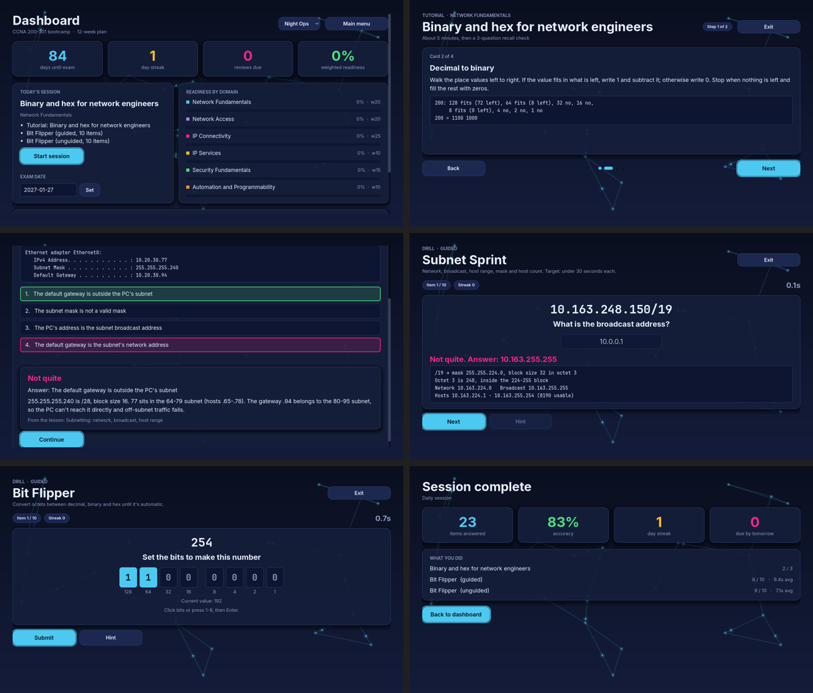
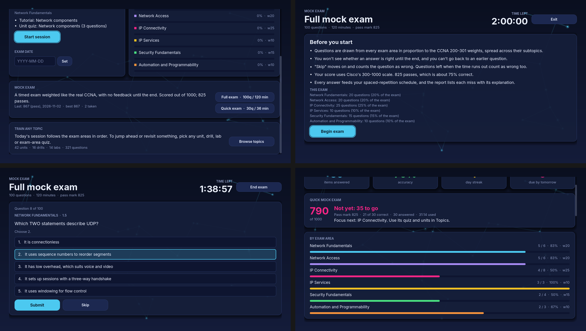
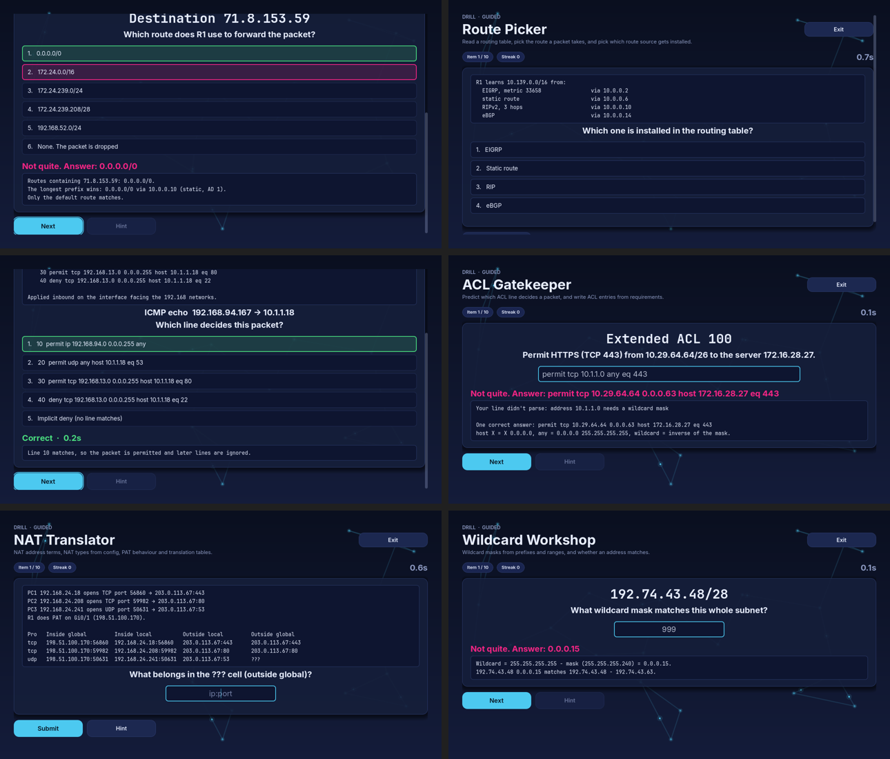
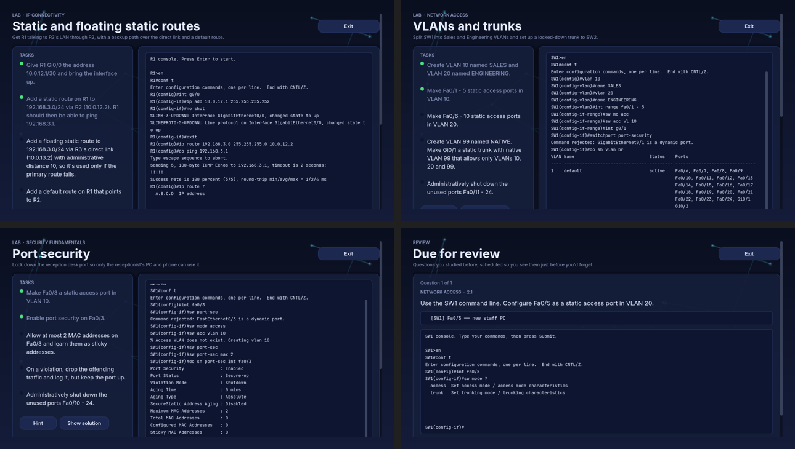
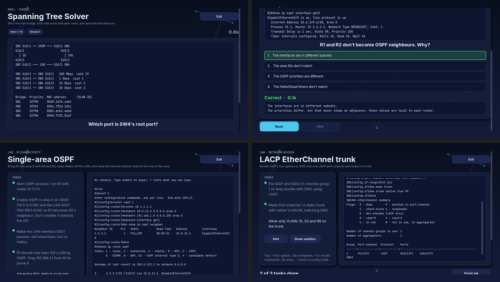
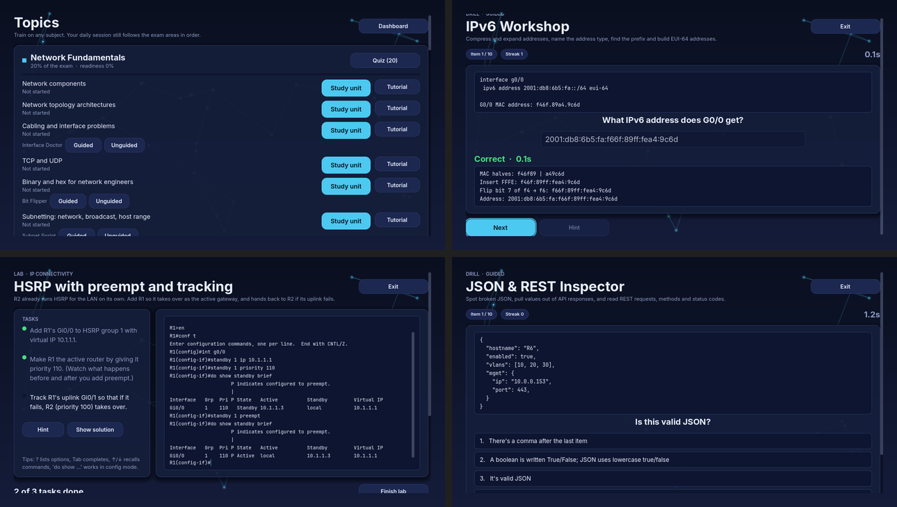
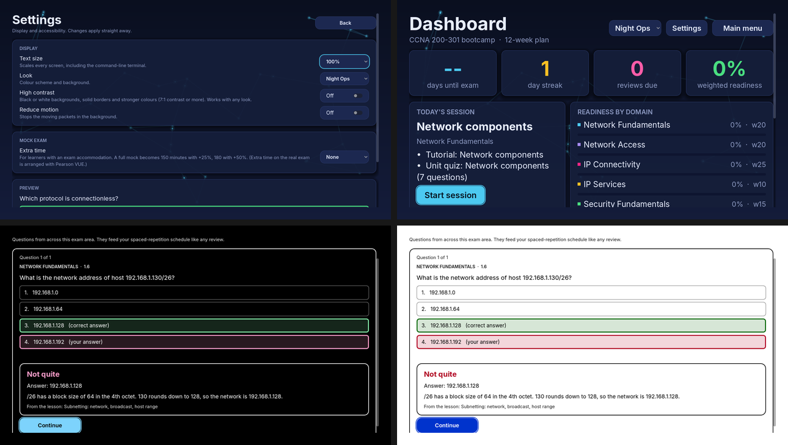
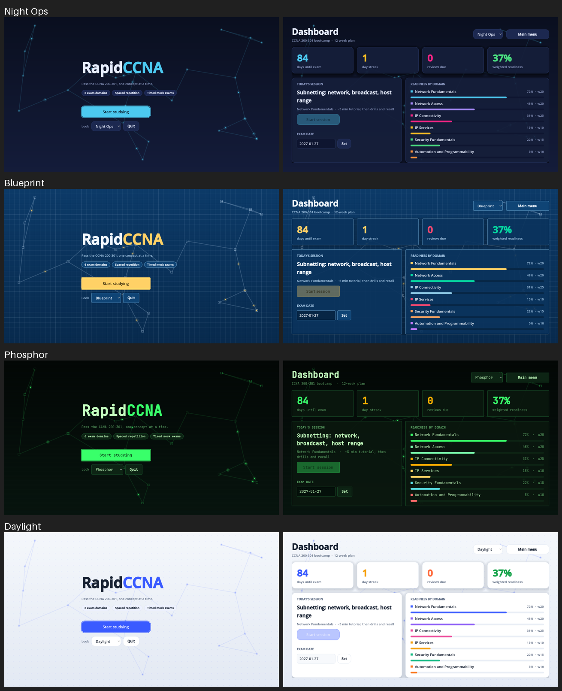

# RapidCCNA

A Godot 4 study game for the **CCNA 200-301** exam. Each unit runs **tutorial → guided drill → unguided drill → spaced-repetition recall**. A timed mock exam covers all six exam domains. The game puts learning ahead of gameplay.

All question content is original and written in exam style. The game does not use real Cisco exam items.

## Status: milestone M7 in progress (accessibility and web build done; content QA next)
| Milestone | Scope | State |
|---|---|---|
| M0 | Project, autoloads, save/load, content loader + validator, tests, export presets, menu → dashboard | ✅ |
| M1 | Tutorial screen, question views, SRS-driven Daily Session, Subnet Sprint, Bit Flipper | ✅ |
| M2 | Networking logic engine (IPv4/IPv6, routing, ACL, NAT) + its drills | ✅ |
| M3 | Scoped IOS CLI simulator + config labs | ✅ |
| M4 | STP / OSPF / EtherChannel / MAC table puzzles | ✅ |
| M5 | All tutorials and remaining mini-games | ✅ |
| M6 | Mock exam (100 q / 120 min, weighted), 600+ question bank | ✅ |
| M7 | Accessibility, web tuning, content QA | 🚧 parts 1-2: accessibility, web build |

**Content:** 42 lessons covering all 53 blueprint subtopics, 600 questions split by exam weight (120/120/150/60/90/60), with at least 5 per subtopic, 600 in total and enough in every exam area to fill a full mock exam, all enforced in CI, 16 drills and 14 labs (plus 18 hidden mini-labs behind `cli_task` questions).

## How a study session works
The dashboard plans each day's session:
1. **Review:** questions that spaced repetition says are due.
2. **Drill refreshers:** short unguided rounds for generated drill skills that are due.
3. **Next unit:** the first unmastered lesson. You get its tutorial (once), a **guided** drill round (hints, place values, a worked solution after every item) until you have 10 unguided attempts, then an **unguided** round. Units without a drill (theory topics and lab-only units) end with a **unit quiz** on their own questions instead. Accuracy over the last 20 unguided attempts or quiz answers drives mastery (85% or better).

The daily plan always follows the exam areas in order. To study anything else, use **Topics** (from the dashboard): every exam area has a quiz, and every unit has *Study unit* (tutorial if new, drills, labs), *Tutorial*, per-drill Guided/Unguided buttons and its labs. Free training updates the same progress and spaced-repetition schedule.

Every answer shows an explanation. A miss always shows the worked solution. Drill skills are graded once per round, so a 10-item round doesn't inflate review intervals.



## Mock exam
Start it from the dashboard: a **full exam** (100 questions, 120 minutes) or a **quick exam** (30 questions, 36 minutes), both set in `content/blueprint.json`.
- **Weighted like the real exam:** each exam area gets seats by its blueprint weight (20/20/25/10/15/10; largest remainder, so a 30-question exam is 6/6/8/3/4/3). Within an area, questions are dealt round-robin across subtopics so one big subtopic can't crowd out the rest. Questions from your previous mock are used only once fresh ones run out. CLI tasks are capped at 5% because they take longer.
- **Exam conditions:** a countdown, no feedback, no going back. "Skip" and anything left when time runs out count as wrong. "End exam" asks for a second press.
- **Score:** Cisco doesn't publish its scaling, so the score is the weight-adjusted fraction correct mapped onto 300-1000. 825 passes, which is about 75%.
- **Report:** pass or fail, the score, a per-area breakdown, the area costing you the most points, and every missed question with your answer, the right answer and the explanation. Answers feed spaced repetition and unit mastery like any review. The last 30 results are saved and the dashboard shows the latest and best scores.

The selection and scoring live in `core/exam/MockExam.gd` (pure logic, unit-tested). The validator fails if any area has too few questions to fill a full mock.



## Drills
| Drill | Unit | What you practise |
|---|---|---|
| Bit Flipper | Binary and hex | Decimal, binary and hex conversions on single octets |
| Subnet Sprint | Subnetting | Network, broadcast, host range, mask and host count |
| Route Picker | Reading the routing table | Longest-prefix match on a generated `show ip route`; which source wins by AD |
| Wildcard Workshop | Wildcard masks | Wildcards from prefixes and ranges; does an address match |
| ACL Gatekeeper | Access control lists | Which ACE decides a packet (incl. implicit deny); write an ACE from a requirement (checked by behaviour, so `host X` = `X 0.0.0.0` and `eq www` = `eq 80`) |
| NAT Translator | NAT and PAT | The four NAT addresses, NAT type from config, PAT port behaviour, reading `show ip nat translations` |
| Frame Forwarder | How a switch forwards frames | Forward, flood or filter; the exact ports a frame leaves on (typed, any order); source learning and moved hosts; per-VLAN lookups in `show mac address-table` |
| Channel Builder | EtherChannel | Which mode pairs bundle (LACP, PAgP, on), the partner mode a side needs, why a member is suspended, reading `show etherchannel summary` |
| Spanning Tree Solver | Rapid PVST+ | Root election (priority, sys-id-ext, MAC), root ports with every tiebreak, port roles, the blocked port and root path cost on generated triangle, ring and parallel-link topologies |
| IPv6 Workshop | IPv6 addressing | Compress (strict RFC 5952: a valid but longer form is marked wrong, with the reason) and expand addresses, address types, /48-/64 prefixes, EUI-64 addresses |
| Interface Doctor | Cabling and interface problems | Straight-through, crossover or rollover; UTP vs multimode vs single-mode by distance; autonegotiation fallback; diagnosing `show interfaces` (shutdown, no link, duplex mismatch from either side, bad cable, err-disabled) |
| Wi-Fi Channel Planner | Wireless principles | Pick the free 2.4 GHz channel for a new AP on a floor plan, channel overlap, 2.4 vs 5 GHz, 802.11 standards, SSID/BSSID/BSS/ESS |
| HSRP Election | First hop redundancy | Who's active (priority, then IP), preempt timelines, whether a tracking decrement really hands over, virtual MACs (HSRPv1/v2, VRRP) both ways, HSRP vs VRRP vs GLBP |
| Service Desk | SNMP, syslog, TFTP and FTP | Service ports (with same-number wrong-transport distractors), syslog severities, whether a real log message passes `logging trap`, DSCP/AF arithmetic, DHCP DORA and relay, SNMP |
| JSON & REST Inspector | JSON-encoded data | Is this JSON valid and why not (trailing comma, single quotes, unquoted key, missing comma, `True`, comments), values at a path like `interfaces[1].ipv4.prefix`, JSON types, CRUD to HTTP methods, status codes, reading an API request |
| OSPF Navigator | Single-area OSPFv2 | Router ID order, DR/BDR election, why two routers won't peer, interface cost and reference bandwidth, best path and ECMP, network statements, the neighbour table |

Generated drills share one screen (`minigames/GenDrill.gd`). A drill is a `drills.json` entry plus a generator script with `make_item(rng)` (and `check()` for typed answers), so adding one needs no UI code.



The M4 puzzles sit on pure engines in `core/net`: `STP` (bridge IDs, root and designated ports, alternate ports), `OSPF` (router ID, DR/BDR, cost, SPF with equal-cost paths, neighbour requirements), `EtherChannel` (negotiation and member consistency) and `MacTable` (per-VLAN learning and forwarding). The labs use the same engines, so a drill and a lab never disagree.

## Command-line labs
`core/ios` simulates the CCNA subset of Cisco IOS:
- **Modes and prompts:** `>`, `#`, `(config)#`, `(config-if)#`, `(config-if-range)#`, `(config-vlan)#`, `(config-line)#`, `(config-std/ext-nacl)#`, `(config-router)#`.
- **Parsing:** abbreviations (`sh ip int br`), `do`, global commands from sub-modes, and IOS errors (`^` marker, `% Incomplete command.`, `% Ambiguous command`).
- **Help:** `?` help, Tab completion and ↑/↓ history in the terminal.
- **Configuration:** interfaces and ranges, VLANs, access and trunk ports (native and allowed lists), static and floating static routes, numbered and named ACLs, NAT (static, pool and overload), port security, lines and passwords.
- **OSPF:** `router ospf`, `router-id`, `network ... area`, `ip ospf <pid> area`, `passive-interface` (and `default`), `auto-cost reference-bandwidth`, `default-information originate`, `ip ospf cost/priority/hello-interval/dead-interval`. Adjacencies follow the real rules (area, subnet, timers, unique router ID, passive). DR/BDR is elected per link, SPF installs `O` routes (loopbacks as /32, `O*E2` defaults), and they are withdrawn when a link fails.
- **EtherChannel:** `channel-group N mode active|passive|desirable|auto|on` creates `Port-channelN`. Members bundle only if both ends' modes negotiate and their switchport settings match the port-channel; otherwise they show `I`, `s` or `D`. Port-channel settings are applied to the members.
- **Spanning tree:** `spanning-tree mode rapid-pvst`, `vlan N priority` (multiples of 4096 enforced), `vlan N root primary/secondary` (goes 4096 below a lower current root), `portfast`, `bpduguard enable`, `cost`. The tree is computed per VLAN over trunks and access links with a bundle as one link, and re-converges when a link goes down.
- **Show commands:** `running-config [interface]`, `ip interface brief`, `vlan brief`, `interfaces trunk`, `ip route [ospf]`, `access-lists`, `ip nat translations`, `port-security [interface]`, `ip ospf neighbor`, `ip ospf interface [brief | <if>]`, `ip protocols`, `spanning-tree [vlan N]`, `etherchannel summary`.
- **Realistic behaviour:** IOS-like rejections such as "Bad mask", "overlaps with", "is a dynamic port" and "Access VLAN does not exist. Creating vlan".
- **CDP and LLDP:** `cdp run`, `lldp run`, per-port `cdp enable` and `lldp transmit/receive`; `show cdp [neighbors [detail]]`, `show lldp [neighbors]`. Neighbours come from the lab's cabling. Lab devices can be non-Cisco (LLDP-only APs, phones) with their own platform and capabilities.
- **HSRP:** `standby N ip/priority/preempt/track`, `standby version 2`; `show standby [brief]`. Elections are stateful and advance after every command: a higher-priority router that joins later stays standby until it has `preempt`, and tracking hands the role over when an uplink fails. The active router answers for the virtual IP.
- **DHCP:** pools (`network`, `default-router`, `dns-server`), `ip dhcp excluded-address`, `ip helper-address`; `show ip dhcp binding/pool`. DHCP-client hosts lease addresses from their gateway's pool or through a relay, which works only if relay and server can reach each other both ways.
- **Device access:** `enable secret` / `enable password`, `service password-encryption` (type 7 in the config), line `password`, `login` / `login local`, `exec-timeout`, `transport input` (ssh, telnet, both, all or none).
- **Management services:** `ip domain name`, `crypto key generate rsa` (with the IOS hostname/domain prerequisites), `ip ssh version 2`, `username ... secret`, `ntp server`, `logging host/trap`, `service timestamps`, `snmp-server community/location/contact`; `show ip ssh`, `show ntp associations`, `show logging`.
- **`ping`:** follows each device's routing table hop by hop across the lab's links, so it fails if either direction is missing a route.

A lab (`content/labs/*.json`) defines devices, startup config, links, tasks and a model solution. Tasks are checked live against device **behaviour** (`route_to`, `ping`, `nat_translates`, `access_port`, `ospf_neighbor`, `etherchannel`, `stp_root`, `stp_role`...), so any valid configuration passes. Tests apply every lab's solution and require all tasks to pass, and require none to pass beforehand. `cli_task` questions embed a small lab in a question for the mock exam.

| Lab | Unit |
|---|---|
| VLANs and trunks | VLANs and trunks (2.1, 2.2) |
| Static and floating static routes | Static routing (3.3) |
| NAT and PAT on an edge router | NAT and PAT (4.1) |
| Port security | Port security (5.7) |
| LACP EtherChannel trunk | EtherChannel (2.4) |
| Root bridges and edge ports (per-VLAN root and backup root, PortFast, BPDU Guard; two switch consoles) | Rapid PVST+ (2.5) |
| Single-area OSPF (router ID, network statements, passive LAN, default-information originate) | Single-area OSPFv2 (3.4) |
| Fix an OSPF adjacency (troubleshooting: area and Hello mismatch) | Single-area OSPFv2 (3.4) |
| Map the network with CDP and LLDP (unlabelled ports, a non-Cisco AP, a public kiosk port) | CDP and LLDP (2.3) |
| HSRP with preempt and tracking | First hop redundancy (3.5) |
| DHCP server and relay | DHCP and DNS (4.3, 4.6) |
| Time, logs and monitoring (NTP, syslog, read-only SNMP limited by an ACL) | SNMP, syslog, TFTP and FTP (4.2, 4.4, 4.5) |
| SSH-only remote access | SSH remote access (4.8) |
| Lock down device access (enable secret, console and VTY login, password encryption) | Device passwords and password policy (5.3, 5.4) |







## Accessibility
**Settings** (from the main menu or the dashboard) apply straight away and are saved separately from progress:
- **Text size** 85-150%, for every screen including the command-line terminal.
- **High contrast** turns any look into black or white surfaces with solid 2 px borders and no backdrop. Every text colour is at least 7:1 (WCAG AAA) and keeps the look's font.
- **Reduce motion** stops the animated packets in the background.
- **Mock exam extra time** of +25%, +50% or +100%, for learners with an exam accommodation. The exam screen shows when it's included.

Right and wrong answers are never shown by colour alone: answered choices are labelled "(correct answer)" and "(your answer)", in questions and drills alike. Every look meets WCAG AA (4.5:1) for all text colours on cards, including feedback colours and the exam clock warning. `test_theme.gd` checks this for every look and its high-contrast version. Everything can be driven from the keyboard: digits pick choices, Enter submits and continues, and Tab moves focus with a visible ring.



## Web build
`godot --headless --path . --export-release Web build/web/index.html` builds a single-threaded web version that needs no special server headers. Godot only needs the two web export templates, and `tools/fetch_web_templates.py` installs just those (about 17 MB, read out of the 1 GB template archive). CI exports the web build on every push and attaches it as the `rapidccna-web` artifact.
- **Size:** about 37 MB as files (35 MB engine, 2 MB game data) or **9.6 MB gzipped**, so serve it with gzip or Brotli. `docs/` holds a `.gdignore` file, so the README screenshots aren't packed into the game.
- **Progress** saves to the browser's IndexedDB and survives reloads. It's tied to the site's address, and clearing site data erases it.
- **Small screens:** windows smaller than 1280x720 get a smaller logical canvas, down to 960x360, so text stays readable instead of shrinking. Body text is about 14 px on a phone held sideways, and desktop windows of 1280x720 or more are unchanged. Every screen fits at 960x360. Narrow portrait screens get a "turn your device sideways" prompt, with a "Continue anyway" button. See `autoload/Display.gd`.
- **Touch** taps and drag-scrolling work through Godot's mouse emulation. Typing into fill-in answers and the CLI on a phone depends on the browser's on-screen keyboard and hasn't been tested on real devices.
- The Quit button is hidden, because a page can't close its own tab.

## UI looks (prototype)
Four switchable looks are defined in `ui/theme/Palette.gd` and built into Godot themes by `ui/theme/ThemeFactory.gd`. The animated network backdrop is `ui/components/Backdrop.gd`. Night Ops is the default. Switch looks from the dropdown on the dashboard or in Settings.

Fonts are bundled in `assets/fonts/` (SIL Open Font License; licences alongside): **Inter** for most looks and **JetBrains Mono** for Phosphor, each in Regular, SemiBold and Bold.



## Layout
```
autoload/   Settings, ContentDB, SRS (SM-2), Progress (save/mastery/streak), SessionManager, Display (small screens)
core/       Pure logic (no UI): exam/ (MockExam: weighted selection, scaled scoring),
            net/ (IPv4, IPv6, RoutingTable, ACL, NAT, STP, OSPF, EtherChannel, MacTable
            + item generators), ios/ (Device, Network, CLI, Commands, Show, Validator, LabSession,
            OspfSim, L2Sim), question/ (Grader), JsonIO
assets/     fonts/ (Inter, JetBrains Mono + licences)
ui/         theme/ (Palette, ThemeFactory), components/ (UI, Backdrop, QuestionView, QuestionRunner, ScreenHeader, Terminal,
            ExamReport), screens/ (MainMenu, Dashboard, Topics, Tutorial, Review, DrillHost, Lab, MockExam, Summary,
            SettingsScreen)
minigames/  DrillBase + SubnetSprint, BitFlipper, GenDrill (generator-driven drills)
content/    blueprint.json, lessons/, questions/, drills/, labs/ (all JSON)
tests/      GUT unit tests + fixtures
tools/      validate_content.py, install_gut.sh, smoke_session.gd (end-to-end), fetch_web_templates.py
```

## Running
Requires Godot 4.3+.
```bash
tools/install_gut.sh                                      # once, for tests
godot --path .                                            # play
godot --headless --path . -s addons/gut/gut_cmdln.gd      # unit tests
python3 tools/validate_content.py                         # content checks
godot --headless --path . -s res://tools/smoke_session.gd # plays a daily session and a quick mock end to end
python3 tools/validate_content.py --min-per-subtopic 5 --min-total 600  # coverage + mock-exam gate (CI)
godot --headless --path . --export-release Linux          # export (needs export templates)
python3 tools/fetch_web_templates.py                      # once, for the web export
godot --headless --path . --export-release Web build/web/index.html
```
Saves go to `user://save.json` (on Linux: `~/.local/share/godot/app_userdata/RapidCCNA/`).

## Adding content
- **Lesson** (`content/lessons/<domain>/<unit>.json`): `id, domain, subtopics[], order, title, cards[3-8]{heading, body}, recall[question ids]`.
- **Questions** (`content/questions/<domain>.json`, an array): `id, domain, subtopic, type, stem, choices?, answer, explanation, lesson_ref, difficulty`.
  - `mcq_single`: `choices`, `answer` is an index. `exhibit` is the same plus an `exhibit` text block (show output, ipconfig and so on).
  - `mcq_multi`: `answer` is a list of 2 or more indices.
  - `fill_in`: `answer` is a string or a list of accepted strings. IPs and numbers compare by value.
  - `drag_match`: `answer` maps left to right, with optional `distractors`.
  - `drag_order`: `answer` is the items in the correct order (they are shuffled for display).
  - `subnet_calc`: `fields` [{key, label, placeholder}] plus an `answer` object with the same keys.
  - `cli_task`: `lab` (a lab id, usually `hidden: true`) plus `answer` (a model answer to display). It's graded by the lab's checks.
- **Lessons** can list `drills` (ids from `content/drills/drills.json`) and `labs`, and give cards an optional monospace `example`.
- Every `subtopic` must match the blueprint numbering (for example `1.6`). Run the validator before committing.
